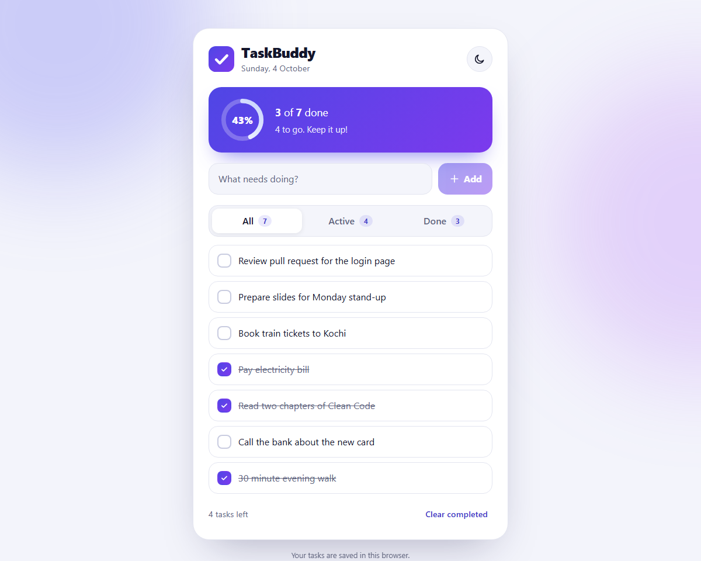
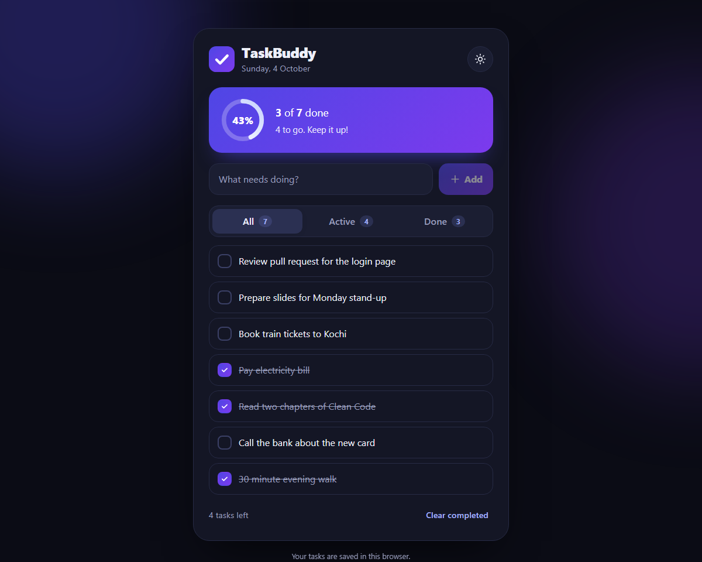
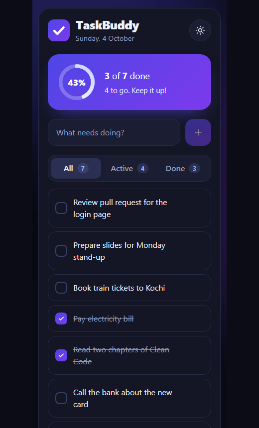
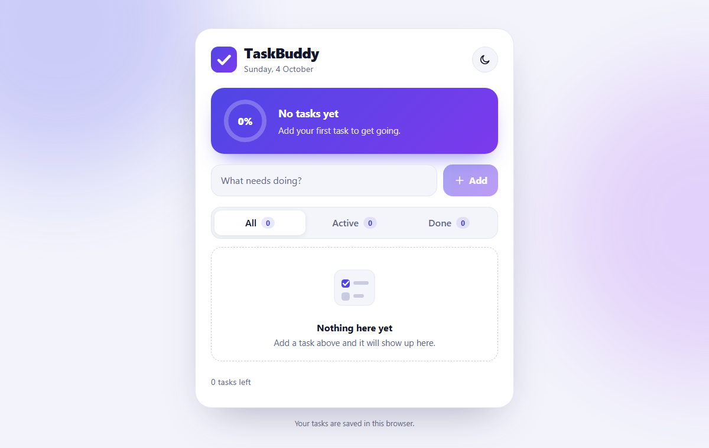

# TaskBuddy

A fast, polished to-do app built with **React** and **Vite**. Light and dark themes, a live progress ring,
smooth micro-interactions, and no UI library: every component and style is hand-written.

**Live demo: [pranavkk7.github.io/taskbuddy](https://pranavkk7.github.io/taskbuddy/)**

| Light | Dark |
|---|---|
|  |  |

| Phone | Empty state |
|---|---|
|  |  |

## Features
- Add, complete and delete tasks with instant updates
- **Progress ring** that fills as you tick tasks off, with an encouraging status line
- Filter by All / Active / Done, each showing its count, and clear completed tasks in one click
- **Light and dark themes:** follows your system at first, then remembers your choice (no flash on load)
- Tasks persist in `localStorage`, and corrupted saved data can never crash the app
- A first visit opens with a few **sample tasks**, so the app is never a blank screen; once you change or
  clear the list, only your own tasks are kept
- Responsive from phone to desktop, with friendly empty states
- **Accessible:** real checkboxes and labels behind the custom visuals, visible keyboard focus, ARIA progress
  bar, and animations that switch off for people who prefer reduced motion

## How it is built
```
src/
  lib/tasks.js           pure task logic (add, toggle, remove, filter, stats, safe parsing)
  hooks/useTasks.js      the task list + saving to localStorage
  hooks/useTheme.js      light/dark theme
  components/            Header, ProgressCard, TaskInput, FilterTabs, TaskList, icons
  styles.css             design tokens (CSS variables) for both themes, and all component styles
  App.jsx                puts the pieces together
```
- The task logic is **pure functions** that never change their input, so they are trivial to test and
  safe to use in React state updates.
- State updates use the functional form (`setTasks(current => ...)`), so they always start from the
  latest list.
- Colours, shadows and radii are **CSS variables**; switching theme only swaps the variables.

## Run locally
```bash
npm install
npm run dev
```

## Test, lint and build
```bash
npm test          # 27 tests: task logic + user flows (Vitest, Testing Library)
npm run lint
npm run build
```
The tests click and type like a user: adding with Enter, completing, filtering, deleting, clearing,
reloading, and switching theme.

## Deployment
Every push to `main` runs lint, tests and the build on GitHub Actions; when all of them pass, the app is
published to GitHub Pages. One-time setup: in the repository's **Settings > Pages**, set **Source** to
**GitHub Actions**.

## Tech
React 19, JavaScript, CSS, Vite, Vitest, Testing Library
